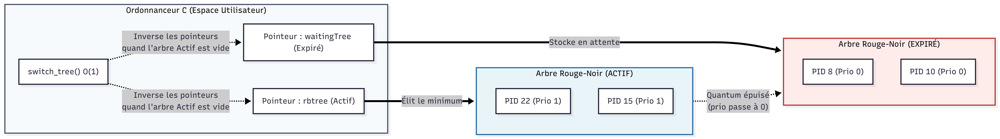

# Miska

## What is Miska?

Miska is a repository containing `sched_ext` schedulers that aim to prioritize tasks with lower PIDs. There are 4 schedulers:
- `scx_ksched`
- `scx_mine`
- `scx_kdyna`
- `scx_dyna`

### `scx_ksched` and `scx_mine`
These two are very basic: they simply look for the lowest eligible PID and schedule it. The main difference between the two is that `scx_ksched` runs almost entirely in the kernel (yes, I know—great creativity with the name) via BPF code, whereas `scx_mine` runs almost entirely in userspace.

We built these two to learn how to write `sched_ext` schedulers and to compare the performance impact and ease of development between userspace and kernel-space scheduling.

### `scx_dyna`



### `scx_kdyna`

$$
\begin{aligned}
\text{priority} &= c \cdot b + \frac{\text{PID}}{1 + \alpha} \\
\alpha &= 0.001 \\
b &= \text{PID MAX} \cdot \alpha \\
c &= \text{cycle number}
\end{aligned}
$$

## Setup and Testing

### Installation

The schedulers have only been tested on Linux kernel `7.2.15`. They should work on most kernels with `sched_ext` support, though upstream API changes may cause compilation failures.

#### On NixOS
1. Enter the Nix shell with `nix develop`
2. Run `make`
3. Start the VM with `./run` or by running the script at `./output-vm/bin/run-nixos-vm`

Once inside the VM, compile the benchmark (`gcc /mnt/work/src/benchmark.c -o bench`) and run it with or without the schedulers (located at `/mnt/work/linux-7.2.15/tools/sched_ext/build/bin/scx_ksched`).

> **Note:** The `vm.nix` script has only been tested on my machine—if it doesn't work for you, feel free to modify it or use your own VM.

#### Other Platforms
Running `make sched` should compile both the Linux kernel and the `sched_ext` schedulers (as long as you have the required build dependencies installed), though you will need to build or configure your own virtual machine.

### Usage and Benchmarking

The schedulers are configured with the `SCX_OPS_SWITCH_PARTIAL` flag, meaning that unless a program explicitly requests `sched_ext`, the kernel will continue scheduling it with `EEVDF`. You can either remove this flag (not recommended) or use the provided benchmark in `src/benchmark.c`.

To test a scheduler, compile `src/benchmark.c` and run it while your chosen scheduler is active. While the schedulers print basic metrics (currently only `average_delay`) to `stdout`, we recommend using `perf` instead as we haven't fully validated the built-in metrics:

```bash
perf sched record -- ./bench
perf sched latency -p
```

Below is an example of installing and setting up the repository (using a precompiled kernel to save time):


